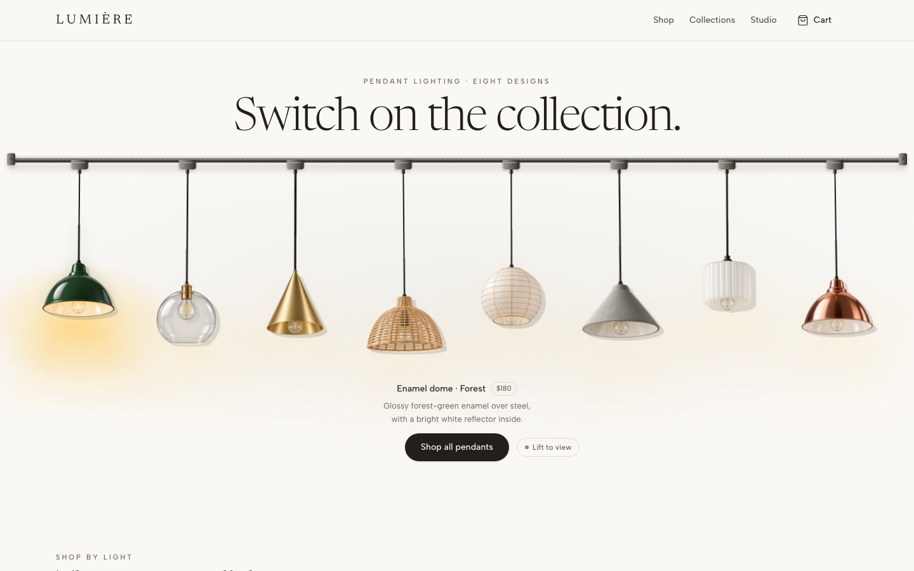
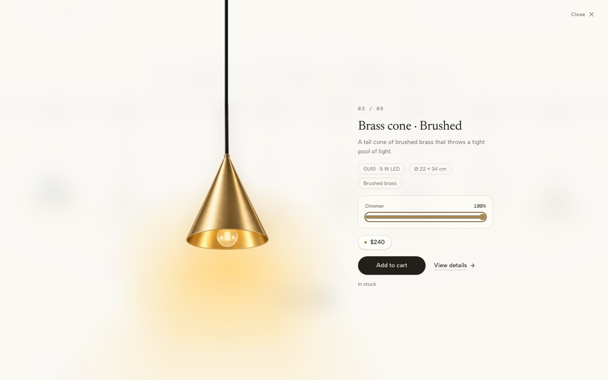
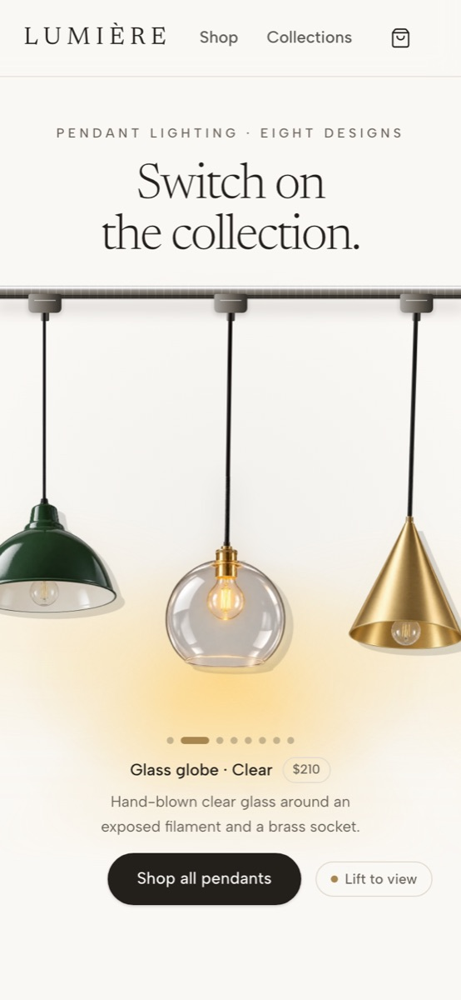

# LUMIÈRE: interactive lighting storefront

A premium storefront for a small pendant-lighting studio, built with Next.js around the 21st.dev **Pendant Lamp Rail**. Visitors brush along a brass track to switch the pendants on, drag them, and lift one into a detail view with a dimmer, then add it to the cart.

**Live demo: [lumiere-lighting-store.vercel.app](https://lumiere-lighting-store.vercel.app)**



| Lamp detail with dimmer | On a phone |
| --- | --- |
|  |  |

What's inside:
- the storefront: rail, shop with filters, collections, product pages and a cart saved in the browser
- optionally, a Supabase catalog with a secure admin for products, photos, orders and inventory
- optionally, Stripe Checkout with stock reservations that can't oversell

**It runs with no accounts at all.** Supabase and Stripe are add-ons you can connect later.

## Quick start (no accounts needed)

Requires [Node.js 22](https://nodejs.org) or newer.

```bash
npm install
npm run dev          # open http://localhost:3000
```

You get the full storefront with eight demo pendants. Nothing is saved anywhere except the cart, in your own browser.

## Run the public demo

The public demo is a locked build for showing the store to anyone:
- It has no admin and no checkout.
- It never connects to Supabase or Stripe, even if their settings are present.

```bash
npm run build:demo
npm run start:demo   # http://localhost:3000 (uses PORT if set)
```

## Make it yours

| Step | Guide |
| --- | --- |
| Change products, copy and photos without a database | `lib/catalog/demo-data.ts`, [docs/ASSETS.md](docs/ASSETS.md) |
| Connect your own Supabase project for a real catalog and admin | [Connect Supabase](#connect-supabase-optional) below |
| Manage products, photos and orders | [docs/ADMIN.md](docs/ADMIN.md) |
| Take payments with Stripe (optional, advanced) | [docs/CHECKOUT.md](docs/CHECKOUT.md) |
| Deploy to Hostinger or any Node.js host | [docs/DEPLOY.md](docs/DEPLOY.md) |
| How it's built | [docs/ARCHITECTURE.md](docs/ARCHITECTURE.md), [docs/SUPABASE.md](docs/SUPABASE.md) |

## Connect Supabase (optional)

1. Create a project at [supabase.com](https://supabase.com); the free plan is enough.
2. In its **SQL Editor**, run these files from `supabase/` in order:
   - `migrations/20261101120000_catalog_and_admin.sql`
   - `migrations/20261101150000_orders_checkout.sql`
   - `seed.sql`

   Each is safe to run again.
3. Click **Connect** in the dashboard and copy the project URL and the **publishable** key.
4. Copy `.env.example` to `.env.local` and fill in `NEXT_PUBLIC_SUPABASE_URL` and `NEXT_PUBLIC_SUPABASE_PUBLISHABLE_KEY`. Then restart `npm run dev`.
5. Create your administrator:
   1. Go to **Authentication → Users → Add user** (Auto Confirm User ticked).
   2. Run this in the SQL Editor:

      ```sql
      insert into public.admin_users (user_id) select id from auth.users where email = 'you@example.com';
      ```
   3. Sign in at `/admin`.
6. Turn off **Allow new users to sign up** (Authentication → Sign In / Providers). The store has no customer accounts.

`.env.local` stays on your machine; Git ignores it. The store and admin use only the publishable key. Checkout's secret key is server-only and optional ([docs/CHECKOUT.md](docs/CHECKOUT.md)).

## Scripts

| Command | What it does |
| --- | --- |
| `npm run dev` | Development server |
| `npm run build`, `npm start` | Production build and server for your store |
| `npm run build:demo`, `npm run start:demo` | The locked public demo |
| `npm run lint` | ESLint |
| `npm run typecheck` | Generates Next.js route types, then runs TypeScript |

## Before you publish your store

The sixteen original lamp photos come from the 21st.dev demo, and **their rights are unverified**: the component's MIT label covers the code only. Replace them with photos you own or have licensed ([docs/ASSETS.md](docs/ASSETS.md)).

## Known limitations

- Checkout has been tested against a simulated Stripe, not a real Stripe account. It offers one flat shipping rate, and has no refunds, discounts or order emails (refund in Stripe; the order keeps its paid status).
- One currency per store (USD by default); the admin's price field is in US dollars.
- The admin can't delete products or edit collections ([docs/ADMIN.md](docs/ADMIN.md)).
- A product hidden directly in the Supabase dashboard, rather than in the admin, can show a not-found page with HTTP 200 for up to 10 seconds.
- Next.js 16 may log `MaxListenersExceededWarning: … 11 close listeners added to [ServerResponse]` when it regenerates a page. It isn't a leak: the count doesn't grow between requests ([next.js discussion #96973](https://github.com/vercel/next.js/discussions/96973)).
- On Windows with classic scrollbars, opening the lamp detail hides the page scrollbar. This is unchanged from the original component.
- Product copy and specifications beyond the original demo are illustrative.

Credits and licenses: [THIRD_PARTY_NOTICES.md](THIRD_PARTY_NOTICES.md).
